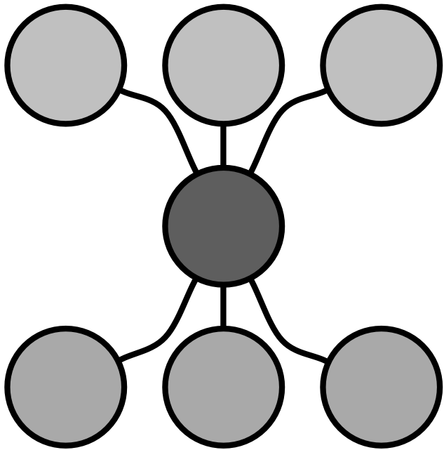
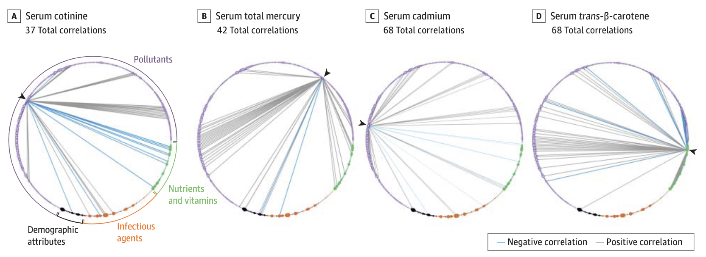
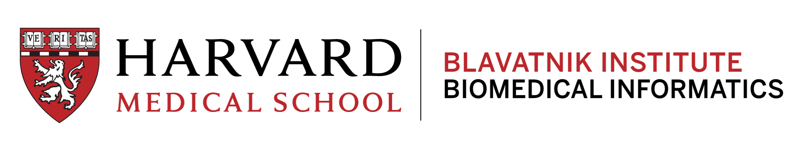

{style="float: right;" fig-alt="dots logo that says \"Data Science of Exposome\"" fig-align="right" width="150"}
The long-term goal of the **Patel Group** is to improve human health by developing powerful computational and AI tools that reason over two forces:  **genetics** and our **environment**.

---

## Modeling the complex phenomena of health and disease
Mechanistic understanding requires looking at human biology from every angle. We specialize in **multi-modal integration**, weaving together data to create a holistic view of health:

* **Multi-omic pathways to health and disease:** We integrate the **proteome** (proteins), **regulome** (how genes are turned on/off), and **exposome** (environmental factors, including the microbiome) to see how the world "gets under our skin" and perturbs biological pathways.
* **From Observation to Experiments:** We map physical manifestations of environmental and genetic interactions in both observational and experimental settings, including randomized trials.
* **Personal and Real-world Signal:** We harness signals from wearables, insurance claims, and satellite data to track health as it happens in the real world.

---

## Leadership in a new paradigm for data-driven discovery
Our research provides the scientific foundation for action. By mapping how the **exposome**—the totality of exposures from lifestyle to pollutants—reshapes behavior, we generate the evidence needed for infrastructure and public health policies that protect the population.

As leaders in [**NEXUS (the Network for Exposomics in the United States)**](https://www.nexus-exposomics.org/), we are building the digital infrastructure necessary to map how a lifetime of environmental exposures shapes our biological reality.

[{fig-align="center"}](https://jamanetwork.com/journals/jama/article-abstract/1877218)

---

## Precision meets preventative medicine and care
We are shifting the focus from population-level inferences to personal decision-making. Instead of relying on general averages, we bring the power of 'omics down to the level of the individual.

* **Prognostic Trajectories:** Using machine learning to project an individual's unique health path based on their molecular signatures and daily exposures and therapeutics.
* **Personalized Sensing:** Building accessible AI tools that allow individuals how a change in behavior or environment might alter their biological future in real-time.
* **Prevention First:** Prioritizing and evaluating  machine learning approaches to screen and treat conditions like **Alzheimer’s, Cancer, and Diabetes** long before they manifest.

---

## Meta-Science: AI in the loop for trustworthy science
Are findings from high-throughput research clinically or biologically useful?  **How can we do the best job possible to ensure big data science is translatable?**

We develop computer intensive approaches to make big data based findings more robust to accelerate [meta science](https://en.wikipedia.org/wiki/Metascience), or the "science of science". We use these data approaches to study how and why we come to the conclusions that we do and if these conclusions are robust. For example, "vibration of effects" attempts to estimate how much arbitrary big data choices can [alter decision making](https://www.chiragjpgroup.org/voe/)! 

---

### Affiliations

We are part of the [Department of Biomedical Informatics](http://dbmi.med.harvard.edu/) at [Harvard Medical School](http://hms.harvard.edu/). We participate in DBMI's educational programs, including:

-   [Artificial Intelligence in Medicine](https://dbmi.hms.harvard.edu/education/phd-program/aim-phd-track),
-   [Bioinformatics and Integrative Genomics](https://bigphd.hms.harvard.edu),
-   [Master's in Biomedical Informatics,](https://dbmi.hms.harvard.edu/education/masters-program)
-   [Summer Institute in Biomedical Informatics](https://dbmi.hms.harvard.edu/education/sibmi)

### Support

We are or have been funded by the [National Institutes of Health](https://reporter.nih.gov/PISearch/9643320), the National Science Foundation, the [Harvard Data Science Institute](https://datascience.harvard.edu), and the [Harvard-Chan NIEHS Center](https://www.hsph.harvard.edu/niehs/). We are thankful for the compute and infrastructural support from Sanofi, Amazon Web Services, Microsoft Azure, Oracle Cloud, and Google.

::: {layout-ncol="1"}
{width="600"}
:::
